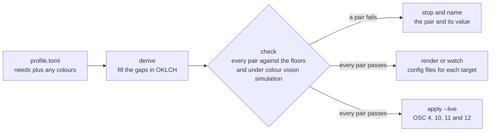

<h1>
  <picture>
    <source media="(prefers-color-scheme: dark)" srcset="assets/profile-lockup-dark.svg">
    
  </picture>
</h1>

State what you need to read a screen once. Get a checked palette in every terminal and editor.

[](https://github.com/zacesshq/profile/actions/workflows/ci.yml)
[](LICENSE)

`zprf` reads a small TOML file that describes needs: a contrast floor, a font and size,
reduced motion, a cursor size, a focus ring, line spacing and a line length. It derives any colour
the file leaves out, checks every foreground and background pair against WCAG 2.2, checks that
neighbouring colours stay apart under simulated colour vision deficiencies and writes config files
for Ghostty, kitty, WezTerm, Alacritty, tmux, Neovim and VS Code. A browser extension applies the
same profile to every web page.

## Why it exists

Every theming tool we know of stores colours. None of them stores needs. A person who needs 7:1
contrast, no blinking and a 16 point font has to find a theme that happens to meet the first need,
then set the other two in every app by hand, then check nothing slipped when the theme changed.

Zacess Profile turns that round. The profile says what has to be true and the tool refuses to write
anything that breaks it:

- **Needs first, palette second.** A profile can be two lines long. Every colour it leaves out is
  solved in OKLCH to meet the profile's own floors.
- **Fails loudly.** A pair below its floor is named with both colours, the measured ratio and the
  floor it missed. `render` writes nothing until every pair passes.
- **Distinct for every viewer.** Neighbouring syntax colours, added and removed lines and errors and
  warnings must differ in tone and stay apart under simulated protanopia, deuteranopia and
  tritanopia, using the same rules as the Zacess themes.
- **More than colour.** Font, size, line spacing, cursor size, focus ring, reduced motion, one
  column, no decoration and a line length ruler are written to each app that has a setting for them.
- **An open format.** The profile is specified in [spec/SPEC.md](spec/SPEC.md) with a
  [JSON Schema](spec/profile.schema.json), versioned apart from the tool, so any app can read a
  profile without it.



## Install

Prebuilt binaries for macOS, Linux and Windows are attached to each GitHub release from the next one
on, along with a Homebrew formula and a winget package. Until then, build from source with a Rust
toolchain (1.88 or newer). This installs the `zprf` command:

```sh
git clone https://github.com/zacesshq/profile.git
cd profile
cargo install --path .
```

## Quick start

Check one of the eight starter profiles, then write its files into a folder of your choosing:

```sh
zprf check profiles/zacess-deep-contrast-dark.toml
zprf render profiles/zacess-deep-contrast-dark.toml --target all --out ./build
```

Or start from needs alone. This profile sets one colour and lets the tool choose the rest:

```toml
spec_version = 1
name = "Warm dark, large text"

[needs]
cursor_size = "large"
line_spacing = 1.3
column_width = 80

[needs.contrast]
text = 7.0

[needs.font]
family = "Atkinson Hyperlegible Mono"
size_pt = 18

[palette]
background = "#1b1612"
```

```sh
zprf derive spec/examples/minimal.toml --out mine.toml
zprf check mine.toml
```

Each colour `derive` chose is marked `# derived`, so you can tell your choices from the tool's.

> [!NOTE]
> `render` only ever writes inside the folder given to `--out`. Copying a file into an app's
> config folder is a step you take yourself. Each rendered file says in its header how to load it.

## Commands

| Command | What it does | Exit code |
| --- | --- | --- |
| `check <profile>...` | Derives any missing colour, then checks every pair of every file given. `--verbose` lists every pair. `--no-derive` also fails a profile that leaves colours to derive | 0 when every profile passes. 1 when a pair fails. 2 when any file is unreadable or invalid or when no colour can be derived to meet a floor. A bad file is reported and the rest are still checked |
| `derive <profile>` | Prints the complete profile with every derived colour marked. `--out <file>` writes it instead | 0 when the result passes. 1 when a colour you set fails, with the profile still printed. 2 when the file is unreadable or invalid or when no colour can be derived to meet a floor |
| `render <profile> --target <name> --out <dir>` | Writes `<dir>/<target>/` from the templates. `--target all` writes every target | 0 when written. 2 when the profile is invalid, cannot be completed or fails a pair, with nothing written |
| `apply <profile> --live` | Sends OSC 4, 10, 11 and 12 to standard output, which recolours the terminal it runs in until the terminal is reset. `--escaped` prints them as readable text with nothing sent, with or without `--live`. `--tmux` wraps them for tmux passthrough | 0 when sent. 2 when the profile is invalid, cannot be completed or fails a pair |
| `watch <profile> --target <name> --out <dir>` | Checks and renders the profile, then does it again each time the file changes. A profile named `name-dark.toml` or `name-light.toml` is paired with the other in the same folder (`--variant` names another) and the variant matching the system's light or dark setting is rendered. Both are written under the id without its ending, so an app can point at one file. A change that fails a pair is reported and the last good files are kept. `--appearance dark` or `light` pins one variant. Runs until Ctrl+C, which ends it the way Ctrl+C ends any command | 2 at the start when the target is unknown, `--out` is empty or the variant given does not exist. A file that cannot be written later is reported and the watch carries on |
| `os <profile> --print` | Prints the system accessibility settings the profile maps to: `defaults write` and `defaults delete` lines on macOS, `gsettings set` on GNOME and `reg add` values with their Settings page on Windows. **A preview only.** zprf never runs them and has no option to. `--platform` prints another platform's lines | 0 when printed. 2 when the profile is invalid or fails a pair |
| `list-targets` | Lists every target with the file it writes | 0 |

A mistyped command or option also exits 2.

## What is checked

Every pair is measured with the WCAG 2.2 contrast formula and held to a floor from
`[needs.contrast]`. The defaults follow the Zacess themes. Panels are `surface` and, when a profile
sets it, the second panel colour `surface_alt` that some apps draw behind their activity and status
bars and inactive tabs.

| Floor | Default | Pairs |
| --- | --- | --- |
| `text` | 7:1 | Text, muted text, links, errors, warnings, information and the accent on the background and on panels. Every syntax colour on the background and on panels. The cursor, the selected text, the text on the accent and the default text over the current line and a soft selection. The default text on any terminal slot listed as a background fill |
| `non_text` | 3:1 | Borders and the focus ring on the background and on panels. The selection block against the background |
| `overlay` | 4.5:1 | Every syntax colour over the current line and over a soft selection. Muted text, links, errors, warnings, information and the accent over the current line |
| `terminal` | 7:1 | The sixteen ANSI colours on the background, apart from slots listed as background fills |
| `terminal_dim` | 4.5:1 | ANSI slots a profile lists in `palette.terminal.dim`, which the light starter profiles use to keep their colours vivid |
| `highlight_distance` | 0.08 | OKLab distance between the background and both the current line and a soft selection, so each stays visible |
| `colour_vision_distance` | 0.04 | OKLab distance between paired colours under simulated protanopia, deuteranopia and tritanopia (Machado, Oliveira and Fernandes, 2009) |
| `tone_difference` | 0.05 | Difference in tone, the cube root of relative luminance, between paired colours, so they differ with no colour vision at all |
| `check_error_warning` | on | Whether errors and warnings are held to the two floors above as a pair |
| `apca` | off | An optional APCA Lc floor for text on the background, checked on top of WCAG |

The paired colours are the neighbouring syntax roles the Zacess themes pair, such as functions and
types or strings and comments, checked when the two share a font style. Strings and numbers,
strings and regular expressions, strings and invalid code, the three diff colours and errors and
warnings are often red and green, so they are checked whatever their style. The full list is in
[the spec](spec/SPEC.md#pairs).

## Targets

| Target | App | File written | What it sets |
| --- | --- | --- | --- |
| `ghostty` | Ghostty | `ghostty/<id>` | Palette, cursor, selection, `minimum-contrast` at the text floor, a block cursor kept through shell integration, cursor blink, font, size, cell height and a solid background |
| `kitty` | kitty | `kitty/<id>.conf` | Palette, cursor, selection, tabs, borders, URL colour, a block cursor kept through shell integration, cursor blink, font, size, cell height, the focus border width, a one column layout and a solid background |
| `wezterm` | WezTerm | `wezterm/<id>.lua` | Palette, tab bar, cursor style and blink, animation rate, font, size, line height and a solid background |
| `alacritty` | Alacritty | `alacritty/<id>.toml` | Palette, cursor, selection, cursor shape and blink, font, size, line offset and a solid background |
| `tmux` | tmux | `tmux/<id>.tmux.conf` | Status bar, windows, pane borders, messages, copy mode, clock and heavy borders for a wide focus ring |
| `neovim` | Neovim | `neovim/colors/<id>.lua` | Editor, syntax, Tree-sitter, diff and diagnostic groups, terminal colours, cursor blink, a column ruler, stacked diffs and no see-through windows |
| `vscode` | VS Code | `vscode/<id>.settings.json` | A `settings.json` fragment: interface and terminal colours, token colours with font styles, font, size, line height, cursor, reduced motion, rulers, editors and diffs in one column, no minimap and `terminal.integrated.minimumContrastRatio` |

[ACCESSIBILITY.md](ACCESSIBILITY.md#needs-each-target-applies) lists each need per app, including
where an app has no setting for one.

Templates are [minijinja](https://github.com/mitsuhiko/minijinja) files in [templates](templates).
Adding a target is a template plus one entry in `src/render.rs`. [CONTRIBUTING.md](CONTRIBUTING.md)
has the steps.

## Starter profiles

The eight Zacess themes ship as complete profiles in [profiles](profiles). Each one passes `check`
with no colour left to derive. CI keeps it that way.

| Profile | Background | Text | Text contrast |
| --- | --- | --- | --- |
| `zacess-light` | `#ffffff` | `#111111` | 18.88:1 |
| `zacess-dark` | `#121212` | `#f5f5f5` | 17.18:1 |
| `zacess-yellow-on-black` | `#000000` | `#ffeb3b` | 17.19:1 |
| `zacess-cream` | `#fdf6e3` | `#000000` | 19.46:1 |
| `zacess-high-contrast-dark` | `#000000` | `#ffffff` | 21.00:1 |
| `zacess-high-contrast-light` | `#ffffff` | `#000000` | 21.00:1 |
| `zacess-deep-contrast-dark` | `#000000` | `#ffffff` | 21.00:1 |
| `zacess-deep-contrast-light` | `#ffffff` | `#000000` | 21.00:1 |

## Browser extension

The [extension](extension) applies a profile to every web page in Chrome and Firefox through CSS
custom properties: colours, font, a minimum text size, spacing, line length, the focus ring and
reduced motion. Its options page reads the same TOML and checks it against the
[JSON Schema](spec/profile.schema.json). It is not in the browser stores yet. Load it unpacked by
following [extension/README.md](extension/README.md).

## Roadmap

[ROADMAP.md](ROADMAP.md) lists what is done, what comes next and what comes later.

## Licence

Zacess Profile is licensed under the [Apache License 2.0](LICENSE). See [NOTICE](NOTICE) for the
copyright notice and <https://www.apache.org/licenses/LICENSE-2.0> for the licence on the web.
